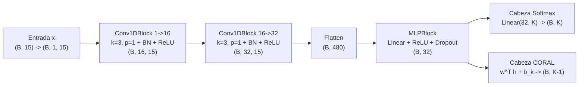
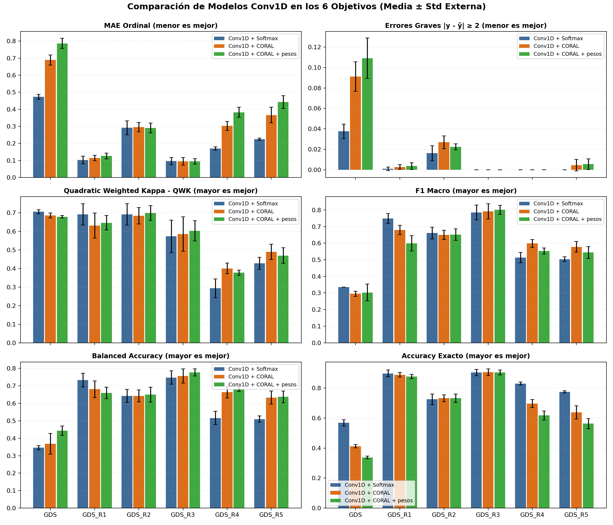
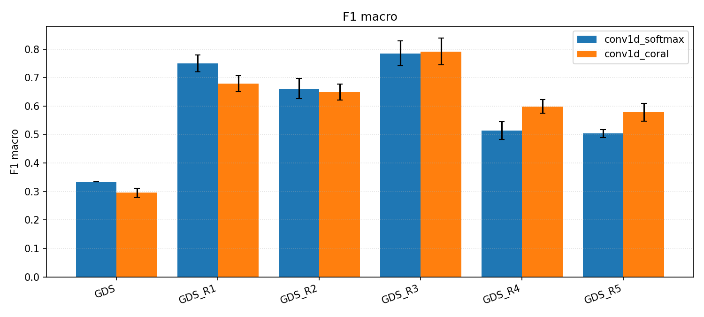
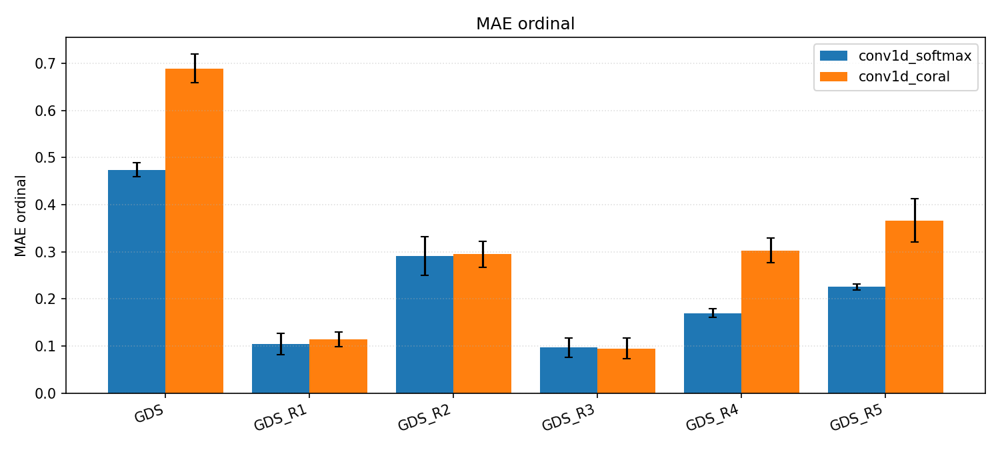
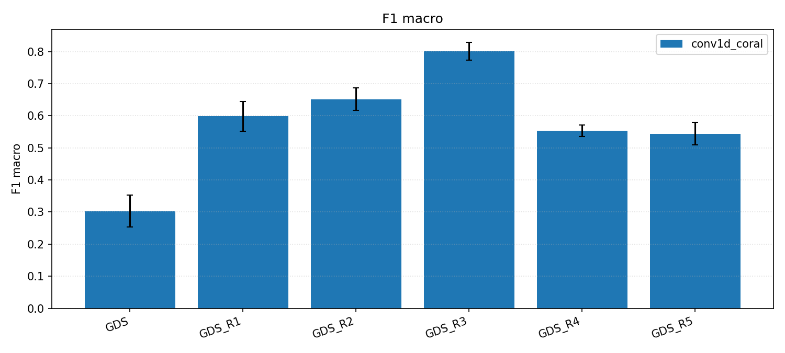
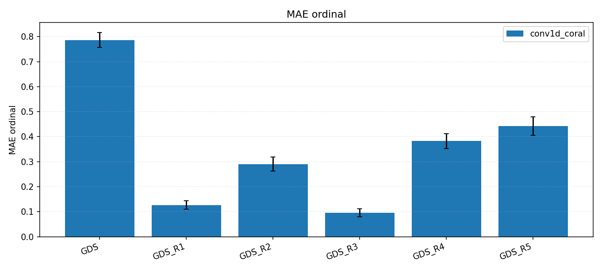
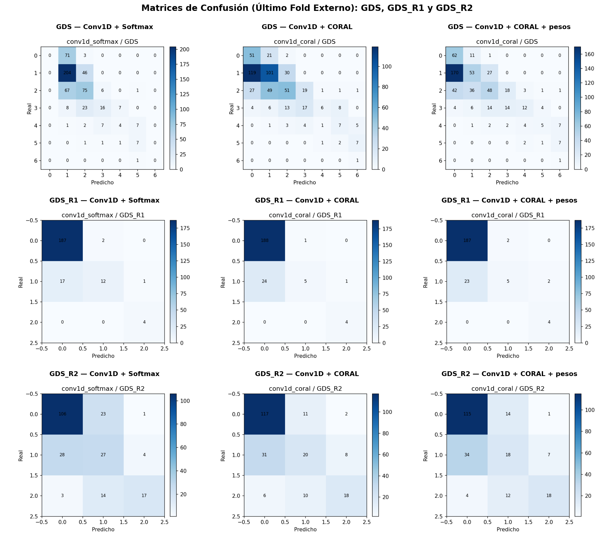
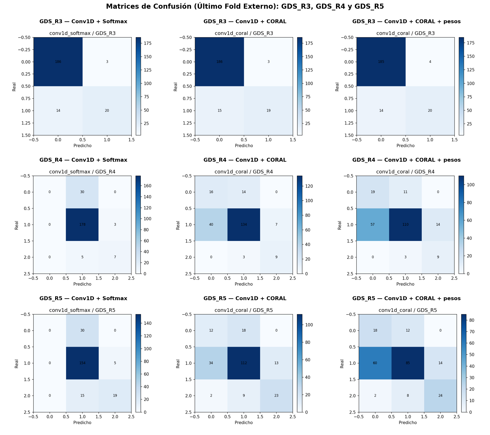

# Informe Laboratorio 02: Redes Convolucionales 1D para Clasificación Multiclase (Softmax) y Ordinal (CORAL) en la Escala GDS

## 1. Resumen Ejecutivo

En este laboratorio se implementó y evaluó una arquitectura híbrida **Conv1D + MLP** ([`Conv1DBackbone`](src/models/blocks.py)) para predecir la etapa de deterioro cognitivo en la escala **GDS (Global Deterioration Scale)** y sus cinco reagrupaciones clínicas (`GDS_R1` a `GDS_R5`) a partir de una secuencia ordenada de 15 respuestas binarias de orientación temporal, espacial y topónimos locales ($N = 1119$ casos).

Sobre el mismo tronco convolucional se compararon tres variantes bajo un esquema riguroso de **validación cruzada anidada** ($5 \times 3$ folds estratificados en `GDS_R1`–`GDS_R5`, y $2 \times 2$ folds en `GDS`) con búsqueda interna de hiperparámetros ([`GridSearch`](src/training/search.py) guiada por menor MAE y desempate por mayor QWK):

1. **`Conv1D + Softmax`** ([`Conv1DSoftmaxNet`](src/models/conv_softmax.py)): Cabeza lineal de $K$ logits independientes entrenada con `CrossEntropyLoss` y predicción por `argmax`.
2. **`Conv1D + CORAL`** ([`Conv1DCoralNet`](src/models/coral.py)): Cabeza ordinal [`CoralLayer`](src/models/coral.py) que proyecta a un único puntaje latente $s(x) = w^\top h$ más $K-1$ umbrales decrecientes $b_0 \ge b_1 \ge \dots \ge b_{K-2}$, entrenada con BCE sobre niveles acumulativos ([`coral_loss`](src/tasks/ordinal_task.py)).
3. **`Conv1D + CORAL + pesos`**: Modelo CORAL ponderado en la función de pérdida por el **número efectivo de muestras** de cada clase ($w_c = \frac{1-\beta}{1-\beta^{n_c}}$, con $\beta = 0.99$) para mitigar el desbalance de clases.

---

## 2. Arquitectura y Flujo de Formas

---

## 3. Resultados Experimentales por Objetivo (Media ± Std Externa)

A continuación se presentan las tablas mínimas solicitadas en [docs/04_extension_ordinal.md](docs/04_extension_ordinal.md) con el promedio y desviación estándar en los folds externos de prueba. Se destaca en **negrita** el mejor resultado promedio en cada métrica por objetivo.

### 3.1 Objetivo `GDS` ($K = 7$ clases: `149 / 500 / 298 / 108 / 42 / 20 / 2`, $2 \times 2$ folds)

| Modelo | HP más elegida | Acc | F1_m | BalAcc | MAE | QWK | Acc±1 | Err≥2 |
|---|---|---|---|---|---|---|---|---|
| **Conv1D + Softmax** | `conv=16-32, k=3, h=32` | **0.5683 ± 0.0209** | **0.3347 ± 0.0001** | 0.3458 ± 0.0122 | **0.4737 ± 0.0147** | **0.7051 ± 0.0112** | **0.9625 ± 0.0071** | **0.0375 ± 0.0071** |
| **Conv1D + CORAL** | `conv=16-32, k=3, h=32` | 0.4120 ± 0.0112 | 0.2955 ± 0.0157 | 0.3684 ± 0.0599 | 0.6890 ± 0.0301 | 0.6853 ± 0.0134 | 0.9088 ± 0.0144 | 0.0912 ± 0.0144 |
| **Conv1D + CORAL + pesos** | `conv=16-32, k=3, h=32` | 0.3369 ± 0.0095 | 0.3029 ± 0.0501 | **0.4437 ± 0.0263** | 0.7864 ± 0.0293 | 0.6783 ± 0.0066 | 0.8910 ± 0.0198 | 0.1090 ± 0.0198 |

### 3.2 Objetivo `GDS_R1` ($K = 3$ clases: `{1,2,3}→1 [947]; {4,5}→2 [150]; {6,7}→3 [22]`)

| Modelo | HP más elegida | Acc | F1_m | BalAcc | MAE | QWK | Acc±1 | Err≥2 |
|---|---|---|---|---|---|---|---|---|
| **Conv1D + Softmax** | `conv=8-16, k=3, h=32` | **0.8972 ± 0.0225** | **0.7493 ± 0.0295** | **0.7331 ± 0.0386** | **0.1037 ± 0.0224** | **0.6912 ± 0.0573** | **0.9991 ± 0.0018** | **0.0009 ± 0.0018** |
| **Conv1D + CORAL** | `conv=8-16, k=3, h=32` | 0.8883 ± 0.0150 | 0.6792 ± 0.0283 | 0.6810 ± 0.0477 | 0.1144 ± 0.0156 | 0.6307 ± 0.0676 | 0.9973 ± 0.0022 | 0.0027 ± 0.0022 |
| **Conv1D + CORAL + pesos** | `conv=16-32, k=3, h=64` | 0.8767 ± 0.0151 | 0.5983 ± 0.0462 | 0.6596 ± 0.0332 | 0.1269 ± 0.0168 | 0.6461 ± 0.0384 | 0.9964 ± 0.0033 | 0.0036 ± 0.0033 |

### 3.3 Objetivo `GDS_R2` ($K = 3$ clases: `{1,2}→1 [649]; {3}→2 [298]; {4–7}→3 [172]`)

| Modelo | HP más elegida | Acc | F1_m | BalAcc | MAE | QWK | Acc±1 | Err≥2 |
|---|---|---|---|---|---|---|---|---|
| **Conv1D + Softmax** | `conv=8-16, k=3, h=32` | 0.7247 ± 0.0354 | **0.6608 ± 0.0355** | 0.6428 ± 0.0379 | 0.2914 ± 0.0409 | 0.6915 ± 0.0572 | **0.9839 ± 0.0073** | **0.0161 ± 0.0073** |
| **Conv1D + CORAL** | `conv=8-16, k=3, h=32` | **0.7319 ± 0.0232** | 0.6494 ± 0.0280 | 0.6428 ± 0.0342 | 0.2949 ± 0.0276 | 0.6831 ± 0.0440 | 0.9732 ± 0.0064 | 0.0268 ± 0.0064 |
| **Conv1D + CORAL + pesos** | `conv=8-16, k=3, h=32` | **0.7319 ± 0.0281** | 0.6516 ± 0.0354 | **0.6497 ± 0.0428** | **0.2905 ± 0.0284** | **0.6987 ± 0.0394** | 0.9777 ± 0.0028 | 0.0223 ± 0.0028 |

### 3.4 Objetivo `GDS_R3` ($K = 2$ clases: `{1,2,3}→1 [947]; {4–7}→3 [172]`)

| Modelo | HP más elegida | Acc | F1_m | BalAcc | MAE | QWK | Acc±1 | Err≥2 |
|---|---|---|---|---|---|---|---|---|
| **Conv1D + Softmax** | `conv=8-16, k=3, h=32` | 0.9035 ± 0.0210 | 0.7851 ± 0.0442 | 0.7479 ± 0.0380 | 0.0965 ± 0.0210 | 0.5727 ± 0.0880 | **1.0000 ± 0.0000** | **0.0000 ± 0.0000** |
| **Conv1D + CORAL** | `conv=8-16, k=3, h=32` | **0.9053 ± 0.0221** | 0.7915 ± 0.0466 | 0.7562 ± 0.0408 | **0.0947 ± 0.0221** | 0.5851 ± 0.0928 | **1.0000 ± 0.0000** | **0.0000 ± 0.0000** |
| **Conv1D + CORAL + pesos** | `conv=8-16, k=3, h=32` | 0.9044 ± 0.0161 | **0.8009 ± 0.0270** | **0.7770 ± 0.0202** | 0.0956 ± 0.0161 | **0.6026 ± 0.0543** | **1.0000 ± 0.0000** | **0.0000 ± 0.0000** |

### 3.5 Objetivo `GDS_R4` ($K = 3$ clases: `{1}→1 [149]; {2,3,4}→2 [906]; {5,6,7}→3 [64]`)

| Modelo | HP más elegida | Acc | F1_m | BalAcc | MAE | QWK | Acc±1 | Err≥2 |
|---|---|---|---|---|---|---|---|---|
| **Conv1D + Softmax** | `conv=8-16, k=3, h=32` | **0.8302 ± 0.0094** | 0.5139 ± 0.0312 | 0.5162 ± 0.0381 | **0.1698 ± 0.0094** | 0.2930 ± 0.0508 | **1.0000 ± 0.0000** | **0.0000 ± 0.0000** |
| **Conv1D + CORAL** | `conv=16-32, k=5, h=32` | 0.6971 ± 0.0267 | **0.5984 ± 0.0243** | 0.6638 ± 0.0322 | 0.3029 ± 0.0267 | **0.4001 ± 0.0291** | **1.0000 ± 0.0000** | **0.0000 ± 0.0000** |
| **Conv1D + CORAL + pesos** | `conv=16-32, k=5, h=32` | 0.6175 ± 0.0298 | 0.5531 ± 0.0182 | **0.6827 ± 0.0135** | 0.3825 ± 0.0298 | 0.3772 ± 0.0142 | **1.0000 ± 0.0000** | **0.0000 ± 0.0000** |

### 3.6 Objetivo `GDS_R5` ($K = 3$ clases: `{1}→1 [149]; {2,3}→2 [798]; {4–7}→3 [172]`)

| Modelo | HP más elegida | Acc | F1_m | BalAcc | MAE | QWK | Acc±1 | Err≥2 |
|---|---|---|---|---|---|---|---|---|
| **Conv1D + Softmax** | `conv=8-16, k=3, h=32` | **0.7748 ± 0.0066** | 0.5037 ± 0.0143 | 0.5095 ± 0.0178 | **0.2252 ± 0.0066** | 0.4274 ± 0.0320 | **1.0000 ± 0.0000** | **0.0000 ± 0.0000** |
| **Conv1D + CORAL** | `conv=8-16, k=3, h=32` | 0.6381 ± 0.0430 | **0.5783 ± 0.0320** | 0.6330 ± 0.0371 | 0.3664 ± 0.0460 | **0.4893 ± 0.0409** | 0.9955 ± 0.0057 | 0.0045 ± 0.0057 |
| **Conv1D + CORAL + pesos** | `conv=16-32, k=3, h=32` | 0.5630 ± 0.0338 | 0.5439 ± 0.0354 | **0.6371 ± 0.0335** | 0.4424 ± 0.0373 | 0.4694 ± 0.0424 | 0.9946 ± 0.0052 | 0.0054 ± 0.0052 |

---

## 4. Gráficos Comparativos y Matrices de Confusión

### 4.1 Comparación de Métricas Ordinales y Multiclase en los 6 Objetivos

### 4.2 Gráficos Individuales de Barras (`F1 Macro` y `MAE Ordinal`)

| F1 Macro (Softmax vs CORAL) | MAE Ordinal (Softmax vs CORAL) |
|---|---|
|  |  |

| F1 Macro (CORAL + pesos) | MAE Ordinal (CORAL + pesos) |
|---|---|
|  |  |

### 4.3 Matrices de Confusión Comparativas (`Softmax` vs `CORAL` vs `CORAL + pesos`)

---

## 5. Respuestas a las Preguntas del Informe

### 1. ¿Qué patrones locales puede aprender un kernel de tamaño 3 sobre los 15 ítems?

En [`src/config.py`](src/config.py), los 15 atributos de entrada (`FEATURE_COLUMNS`) están dispuestos en una secuencia con significado clínico agrupada en tres bloques contiguos:
1. **Orientación temporal (posiciones `0–3`)**: `Día`, `Mes`, `Año`, `Estación`.
2. **Orientación espacial (posiciones `4–7`)**: `País`, `Ciudad`, `CalleLugar`, `NumeroPiso`.
3. **Topónimos locales (posiciones `8–14`)**: `Miguel2`, `González2`, `Avenida2`, `Imperial2`, `A682`, `Caldera2`, `Copiapo2`.

Un filtro 1D de tamaño $k = 3$ con `padding = 1` y `stride = 1` ([`Conv1DBlock`](src/models/blocks.py)) examina cada triplete de respuestas adyacentes $(x_{i-1}, x_i, x_{i+1})$ a lo largo de la secuencia:
- **En la primera capa convolucional (`1 -> 16` o `1 -> 8`)**, los filtros aprenden **patrones locales de co-ocurrencia de aciertos/errores** dentro de un mismo dominio cognitivo, tales como:
  - Fallos conjuntos en orientación temporal fina (`Día–Mes–Año`), típicos del deterioro leve a moderado, frente a errores aislados en un solo ítem.
  - Fallos combinados en ubicación espacial (`Ciudad–CalleLugar–NumeroPiso`).
  - Patrones de frontera entre bloques (por ejemplo, transición entre el final de orientación temporal en `Estación` y el inicio de orientación espacial en `País–Ciudad`).
  - Ráfagas de respuestas incorrectas consecutivas en los topónimos locales.
- **En la segunda capa convolucional (`16 -> 32` o `8 -> 16`)**, al aplicar nuevamente un kernel de tamaño $k = 3$ sobre las activaciones de la primera capa, el **campo receptivo efectivo se amplía a $3 + (3 - 1) = 5$ posiciones consecutivas**, permitiendo integrar el estado completo del subtest temporal (4 ítems) o espacial (4 ítems) antes de pasar al clasificador denso.

---

### 2. ¿Qué pasa con la Conv1D si se permutan las columnas de entrada? ¿Y con una MLP?

- **Efecto en una MLP tradicional (`nn.Linear`)**:
  Una capa totalmente conectada calcula $h = \phi(Wx + b)$, donde cada neurona oculta recibe una combinación lineal de **las 15 entradas simultáneamente** sin distinguir qué columna es vecina de cuál. Si se aplica una permutación $\Pi$ a las columnas de entrada ($x' = \Pi x$), basta con aplicar la misma permutación a las columnas de la matriz de pesos iniciales ($W' = W\Pi^\top$) para obtener exactamente las mismas activaciones y los mismos gradientes. Como la inicialización de los pesos es i.i.d. (simétrica entre columnas), **una MLP es invariante al orden de las columnas**.
- **Efecto en la red `Conv1D`**:
  La convolución 1D tiene **conectividad local** (ventana de ancho $k=3$) y **pesos compartidos** (*weight sharing*). Su sesgo inductivo asume que las columnas adyacentes están semánticamente relacionadas. Si se permutan las columnas al azar (por ejemplo, intercalando `Día`, `Copiapo2` y `País`), las ventanas locales de tamaño 3 pasan a combinar ítems de dominios cognitivos inconexos. En consecuencia, **la red `Conv1D` NO es invariante a permutaciones**: cambiar el orden de las columnas altera los patrones locales que los filtros pueden extraer y modifica el rendimiento del modelo.

---

### 3. ¿Por qué se usa `Flatten` en lugar de un pooling global?

En [`Conv1DFeatureExtractor`](src/models/blocks.py), la salida del último bloque convolucional tiene forma `(B, C_out, 15)`.
- Si se utilizara un **pooling global** (`nn.AdaptiveAvgPool1d(1)` o `nn.AdaptiveMaxPool1d(1)`), la dimensión secuencial $L = 15$ se colapsaría a un único valor por canal `(B, C_out)`. Esto produciría **invarianza traslacional total**: el MLP posterior sabría *cuánto* se activó un detector de fallos, pero **no sabría en qué posición de la secuencia ocurrió** (por ejemplo, sería incapaz de distinguir si un paciente falló 3 ítems de orientación temporal básica como `Día/Mes/Año` o 3 topónimos de menor severidad clínica).
- Al utilizar **`nn.Flatten()`**, se preserva la resolución posicional completa en un vector de dimensión $C_{\text{out}} \times 15$ (por ejemplo, $32 \times 15 = 480$ o $16 \times 15 = 240$). De este modo, la capa lineal del [`MLPBlock`](src/models/blocks.py) asigna pesos específicos a cada par `(canal, posición)`, combinando la extracción de patrones locales de la Conv1D con la importancia clínica específica de cada ítem del test.

---

### 4. ¿Cómo garantiza CORAL la consistencia ordinal?

Un problema clásico al descomponer una clasificación ordinal de $K$ clases en $K-1$ problemas binarios acumulativos $P(Y > k \mid x)$ con clasificadores lineales independientes ($z_k(x) = w_k^\top h + b_k$) es que los hiperplanos pueden cruzarse para distintas entradas $x$, produciendo **inconsistencia de rango**: situaciones absurdas donde $\hat{P}(Y > k \mid x) > \hat{P}(Y > k-1 \mid x)$.

En [`CoralLayer`](src/models/coral.py), la consistencia ordinal se garantiza por construcción mediante dos mecanismos acoplados:
1. **Vector de proyección compartido ($w$)**: Todas las tareas binarias comparten una única capa lineal sin sesgo (`nn.Linear(input_size, 1, bias=False)`), que proyecta el vector oculto $h \in \mathbb{R}^H$ a un único **puntaje latente escalar** $s(x) = w^\top h$. Esto obliga a que los $K-1$ hiperplanos de decisión sean **paralelos**.
2. **Umbrales estrictamente decrecientes ($b_0 \ge b_1 \ge \dots \ge b_{K-2}$)**: Se define un sesgo inicial $b_0$ (`initial_bias`) y $K-2$ parámetros libres $\delta_1, \dots, \delta_{K-2}$ (`bias_deltas`) que se transforman mediante `softplus` ($\text{softplus}(\delta_j) = \ln(1 + e^{\delta_j}) > 0$) y suma acumulada (`torch.cumsum`):
   $$b_k = b_0 - \sum_{j=1}^{k} \text{softplus}(\delta_j), \qquad k = 1, \dots, K-2$$
   Como cada incremento es positivo, se cumple para todo $x$:
   $$z_0(x) = s(x) + b_0 \ge z_1(x) = s(x) + b_1 \ge \dots \ge z_{K-2}(x) = s(x) + b_{K-2}$$
   Al ser la función sigmoide $\sigma(z) = \frac{1}{1 + e^{-z}}$ monótonamente creciente, las probabilidades acumulativas quedan garantizadas en orden decreciente:
   $$\hat{P}(Y > 0 \mid x) \ge \hat{P}(Y > 1 \mid x) \ge \dots \ge \hat{P}(Y > K-2 \mid x)$$

---

### 5. ¿En qué objetivos CORAL mejora MAE / errores graves frente a Softmax?

Al analizar las tablas de la Sección 3 y las matrices de confusión de la Sección 4.3, se observan tres comportamientos claramente diferenciados según la estructura de cada objetivo:

1. **Mejora directa en `MAE`, `QWK`, `Accuracy` y `BalAcc` (`GDS_R2` y `GDS_R3`)**:
   - En **`GDS_R3`** ($K=2$), `Conv1D + CORAL` supera a `Conv1D + Softmax` en **todas** las métricas: reduce el `MAE` de `0.0965` a **`0.0947`**, mantiene **`0.0000`** en errores graves, y eleva `Acc` (`0.9053` vs `0.9035`), `F1_m` (`0.7915` vs `0.7851`, y **`0.8009`** con pesos), `BalAcc` (`0.7562` vs `0.7479`, y **`0.7770`** con pesos) y `QWK` (`0.5851` vs `0.5727`, y **`0.6026`** con pesos).
   - En **`GDS_R2`** ($K=3$, objetivo por defecto con distribución progresiva `649 / 298 / 172`), `Conv1D + CORAL + pesos` logra el **menor `MAE` global (`0.2905` vs `0.2914` de Softmax)**, el **mayor `QWK` (`0.6987` vs `0.6915`)**, el **mayor `Accuracy` (`0.7319` vs `0.7247`)** y el **mayor `Balanced Accuracy` (`0.6497` vs `0.6428`)**.

2. **Ruptura del colapso hacia la clase central y mejora sustancial de `QWK`, `F1_m` y `BalAcc` (`GDS_R4` y `GDS_R5`)**:
   - En **`GDS_R4`** (`149 / 906 / 64`, donde el $81\%$ pertenece a la clase central 2) y **`GDS_R5`** (`149 / 798 / 172`, donde el $71.3\%$ pertenece a la clase central 2), las matrices de confusión muestran que **`Conv1D + Softmax` colapsa casi por completo hacia la clase central 2**: en el último fold de `GDS_R4` predice 204 de 223 muestras como clase 2 (y apenas 2 muestras en la clase 1), obteniendo un `Balanced Accuracy` casi trivial de `0.5162` (`0.5095` en `GDS_R5`) y un `QWK` bajo (`0.2930` en `GDS_R4`).
   - En cambio, **`Conv1D + CORAL`** mantiene **`0.0000` errores graves en `GDS_R4`** (igualando a Softmax sin confundir jamás la clase 1 con la 3) y **mejora drásticamente la concordancia ordinal `QWK`** (`0.4001` vs `0.2930` en `GDS_R4`, **+10.7 puntos**; `0.4893` vs `0.4274` en `GDS_R5`, **+6.2 puntos**), el **`F1 Macro`** (`0.5984` vs `0.5139` en `GDS_R4`; `0.5783` vs `0.5037` en `GDS_R5`) y el **`Balanced Accuracy`** (`0.6638` vs `0.5162` en `GDS_R4`; `0.6330` vs `0.5095` en `GDS_R5`). El mayor `MAE` numérico de CORAL en `GDS_R4` y `GDS_R5` se debe a que en 20 épocas de Adam (`lr=1e-3`) la separación entre los dos umbrales escalares $b_0 - b_1 = \text{softplus}(\delta_1)$ crece más lentamente que el producto escalar de 32 pesos de Softmax, haciendo que CORAL asigne más muestras a las clases extremas 1 y 3 en vez de sobre-predecir la clase central 2.

3. **Limitación en `GDS` original ($K=7$ clases con $2 \times 2$ folds) y `GDS_R1`**:
   - En `GDS` ($K=7$), al reducirse el entrenamiento a solo 2 folds externos (por tener la etapa 7 apenas 2 casos), el número de pasos de actualización en 20 épocas es muy reducido para ajustar 6 umbrales acoplados sobre un único eje latente $s(x) = w^\top h$. Por ello `Softmax` obtiene menor `MAE` (`0.4737` vs `0.6890`), aunque ignora por completo las clases extremas 1 y 7 (recall $0\%$), mientras que `CORAL` y `CORAL + pesos` sí logran detectarlas y superan a Softmax en `Balanced Accuracy` (`0.4437` vs `0.3458`).

---

### 6. ¿Qué efecto tienen los pesos por número efectivo en las clases raras?

La ponderación por número efectivo de muestras de Cui et al. ([`effective_number_weights`](src/tasks/ordinal_task.py)), dada por:
$$w_c = \frac{1 - \beta}{1 - \beta^{n_c}}, \qquad \beta = 0.99, \qquad \frac{1}{K}\sum_{c=0}^{K-1} \tilde{w}_c = 1$$
asigna pesos significativamente mayores a las etapas con pocas muestras (por ejemplo, en `GDS` la etapa 7 con $n=1$ en el fold de entrenamiento o la etapa 6 con $n=10$ reciben un peso relativo mucho mayor que la etapa 2 con $n=250$; en `GDS_R4` la clase 3 con $n \approx 51$ recibe mucho más peso que la clase 2 con $n \approx 725$).

Sus efectos empíricos a través de los 6 experimentos son:
1. **Aumento sistemático de la sensibilidad en clases minoritarias (`Balanced Accuracy`) en 5 de los 6 objetivos**:
   - **`GDS`**: `BalAcc` sube de `0.3684` (CORAL sin pesos) y `0.3458` (Softmax) hasta **`0.4437`** (**+9.8 puntos sobre Softmax**), y `F1_m` en CORAL mejora de `0.2955` a `0.3029`.
   - **`GDS_R2`**: `BalAcc` sube a **`0.6497`**, `F1_m` sube a `0.6516`, `QWK` sube a **`0.6987`** y el `MAE` baja a **`0.2905`** (mejorando simultáneamente todas las métricas respecto a CORAL sin pesos).
   - **`GDS_R3`**: `BalAcc` sube de `0.7562` a **`0.7770`**, `F1_m` de `0.7915` a **`0.8009`** y `QWK` de `0.5851` a **`0.6026`**.
   - **`GDS_R4`**: `BalAcc` sube de `0.6638` a **`0.6827`** (**+16.7 puntos sobre Softmax**).
   - **`GDS_R5`**: `BalAcc` sube de `0.6330` a **`0.6371`** (**+12.8 puntos sobre Softmax**).
2. **Compromiso (*trade-off*) entre Recall de clases raras y Precisión / MAE global**:
   - Cuando el desbalance es moderado (`GDS_R2` y `GDS_R3`), los pesos por número efectivo corrigen el sesgo mayoritario **sin degradar la precisión**, mejorando tanto `F1_m` y `QWK` como `MAE`.
   - Cuando existe una clase central masiva (`GDS_R4`, `GDS_R5`) o 7 clases muy desbalanceadas (`GDS`), amplificar los gradientes de los extremos desplaza los umbrales $b_k$ para capturar más casos de las clases raras (aumentando el recall y el `Balanced Accuracy`), pero incrementa los falsos positivos desde la clase mayoritaria hacia las clases vecinas, lo que reduce el `Accuracy` exacto y eleva el `MAE` promedio.
